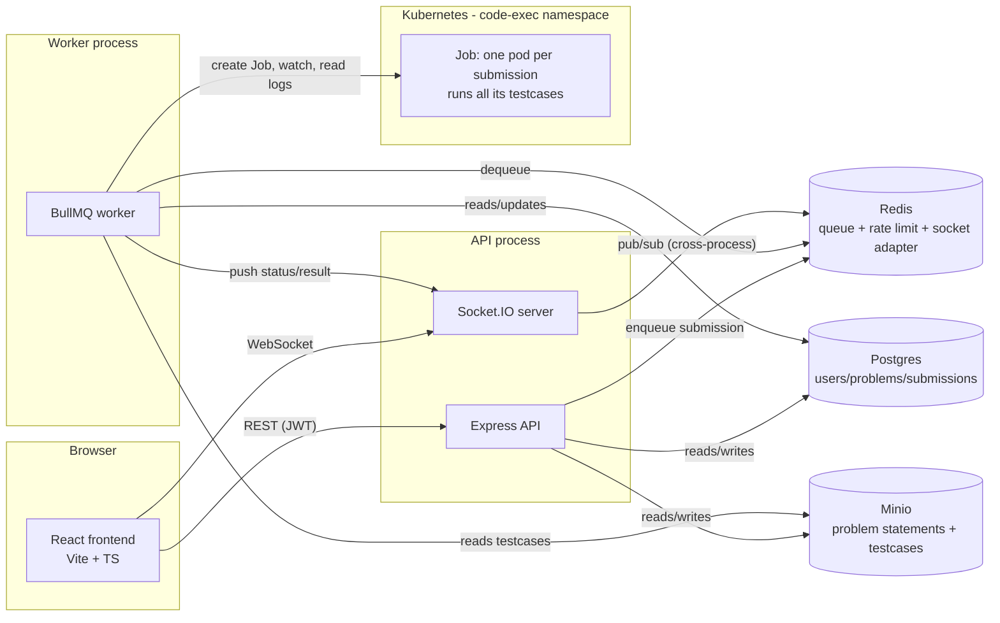
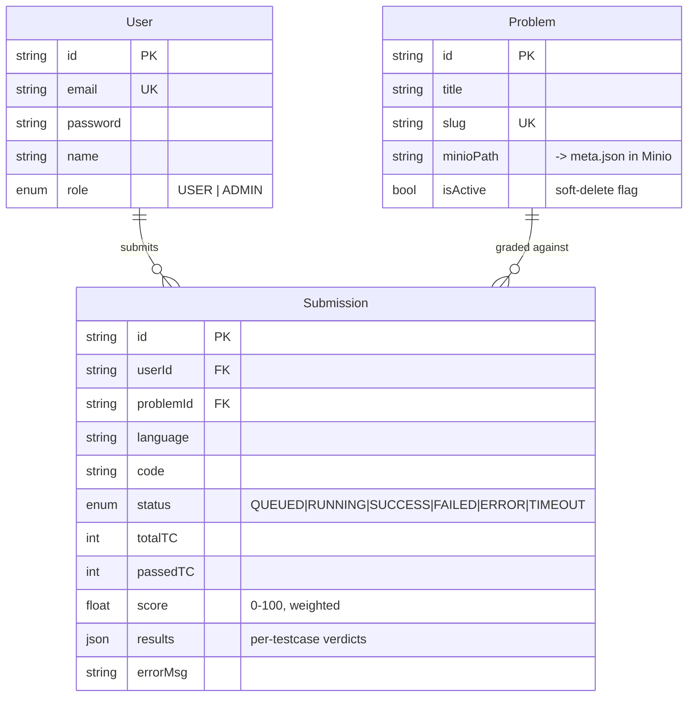
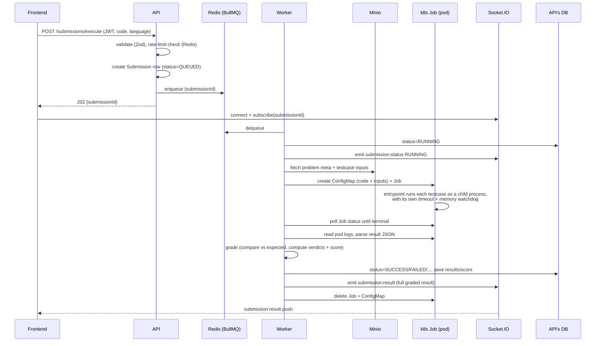

# Architecture & Workflow

For setup/run steps see [`HOW_TO_RUN.md`](HOW_TO_RUN.md). For the API contract
see Swagger at `/api/docs`. This file is about *how the system fits together
and why*, not how to operate it.

A visual version of this same content (diagrams instead of Mermaid source)
is at [`docs/architecture.html`](docs/architecture.html) - open it directly
in a browser.

## 1. System overview



The API and worker are **separate processes** on purpose: the API must stay
responsive even while a submission is grading (which can take seconds), and
the worker is the only thing that talks to Kubernetes. They communicate only
through Postgres (submission state) and Redis (the queue, and the Socket.IO
Redis adapter so a push emitted by the worker reaches a client connected to
the API process).

## 2. Components

| Component | Tech | Responsibility |
|---|---|---|
| Frontend | React 19 + TS + Vite, TanStack Query, React Router, Monaco, Tailwind | Everything user-facing: auth, problem browsing, code editor, live results |
| API | Express + TS | Auth, CRUD, validation (Zod), enqueues submissions, serves Socket.IO, serves Swagger |
| Worker | Node + TS, BullMQ consumer | Dequeues submissions, builds/watches k8s Jobs, grades results, pushes updates |
| Postgres | via Prisma | `User`, `Problem` (reference row only), `Submission` (status/score/results) |
| Redis | ioredis | BullMQ queue, `rate-limit-redis` store, Socket.IO Redis adapter (all three share one instance) |
| Minio | S3-compatible | Problem statements + testcases - kept out of Postgres so problem content is a folder-shaped upload, not DB rows |
| Kubernetes | kind (local) / any cluster (prod) | Sandboxed, resource-limited execution of untrusted submitted code |
| `docker/exec-js`, `docker/exec-python` | Node / Python | Per-language execution images; each has its own entrypoint that runs all of a submission's testcases and watches its own memory |

## 3. Data model



`Problem` in Postgres is deliberately thin - `id`, `title`, `slug`,
`minioPath`, `isActive`. Everything else (description, constraints, time/
memory limits, and every testcase's input/expected-output/weight/hidden
flag) lives in Minio as `problems/{id}/meta.json` +
`problems/{id}/testcases/{n}/input.txt|output.txt`. A new problem is a
folder upload plus one DB row - see `src/services/problem.service.ts`.

## 4. End-to-end workflows

### Auth
Register/login → bcrypt-hashed password check → JWT (`{id, email, role}`)
signed with `JWT_SECRET`, 1 day expiry. No refresh flow - the client just
re-logs-in when it expires. The role is baked into the token at login time,
so promoting a user to admin in the DB doesn't take effect until they log in
again.

### Submitting code



The frontend also polls `GET /submissions/:id` (via TanStack Query's
`refetchInterval`, only while non-terminal) as a fallback baseline - the
socket push updates the same query cache instantly when it arrives, so a
missed/late event self-heals within one poll interval. Belt and suspenders,
deliberately.

### Grading a testcase
`src/services/grading.ts` is the single source of truth for verdicts:
```
timedOut        → TLE
memoryExceeded  → MLE
exitCode !== 0  → RE
stdout matches expected (whitespace-normalized) → AC, else WA
```
`score` is separate from the flat `passedTC/totalTC` count - it's
weighted (`sum(weight of AC testcases) / sum(all weights) * 100`), see
`computeScore()`.

Hidden testcases (`hidden: true` on the problem) get their `execTimeMs` and
`stdout`/`stderr` stripped before the result ever leaves the worker - the
submitter only ever learns pass/fail for those. See `buildGradedResults()`.

## 5. Kubernetes execution model

**One Job per submission**, not one per testcase - all of a submission's
testcases run as sequential child processes inside a single pod
(`src/k8s/jobBuilder.ts`, `docker/exec-*/entrypoint.*`). This was a
deliberate efficiency choice over one-pod-per-testcase, which would multiply
k8s API/scheduling overhead by the testcase count for every submission.

The pod is locked down:
- `runAsNonRoot`, fixed non-root UID, `seccompProfile: RuntimeDefault`
- `readOnlyRootFilesystem: true`, all Linux capabilities dropped, no
  privilege escalation
- `NetworkPolicy` deny-all (untrusted code gets zero network access)
- CPU/memory `resources.limits` from the problem's `timeLimitMs`/
  `memoryLimitMb`
- `activeDeadlineSeconds` as a Job-level timeout backstop
- `ttlSecondsAfterFinished` plus the worker's own explicit delete, so a
  finished Job never lingers

**Per-testcase timeout**: each child process gets its own timeout
(`spawn`/`Popen` + a timer that kills just that child), so one slow testcase
doesn't need the whole Job to fail.

**Per-testcase memory limit (MLE)**: this took real investigation, not just
config. Kubernetes/containerd set `memory.oom.group=1` on a container's
cgroup - confirmed by deploying a pod that deliberately blows memory and
watching `kubectl describe` - which means a kernel OOM kill is *always
whole-container*. There is no pod-spec knob to change that. So a single
memory limit shared by every testcase in the pod can't be policed by the
kernel on a per-testcase basis; the entrypoint has to police itself: a
background watchdog polls each child's own RSS via `/proc/<pid>/status`
every 50ms and kills *that child* the moment it crosses 80% of the pod's
memory limit, well before the cgroup total would trip the kernel's killer.
That keeps the entrypoint process alive to grade the remaining testcases
instead of losing the whole submission to one bad testcase. Verified live:
a submission with one memory-bombing testcase graded that one `MLE` while
the other two still graded normally. The one residual gap: a single
allocation large enough to blow past the limit *between* two 50ms polls can
still race the kernel's whole-container killer and lose - that case still
falls back to the old whole-submission `ERROR`.

**Cleanup**: the worker deletes the Job and ConfigMap in a `finally` block
regardless of outcome; `ttlSecondsAfterFinished: 60` is the backstop in case
the worker itself crashes mid-grade.

## 6. Real-time delivery

Socket.IO on the API process, with the Redis adapter so a client connected
to one API replica still receives an event emitted by the worker process (a
different process entirely) or by a *different* API replica. The worker
never holds a socket connection itself - it emits through
`@socket.io/redis-emitter` into the same Redis pub/sub channel the adapter
listens on. This is what makes horizontal API scaling and the worker's
separateness both work without extra plumbing.

## 7. Security model

- **AuthN**: JWT, bcrypt password hashing.
- **AuthZ**: role check middleware (`ADMIN` for problem create/delete and
  listing all users); ownership checks (a submission is only visible to the
  user who created it).
- **Rate limiting**: 10 `/submissions/execute` calls/min per user, enforced
  via `rate-limit-redis` against the shared Redis - correct across multiple
  API replicas, not just per-process (verified by running two API instances
  against the same Redis and confirming the limit is shared).
- **Sandbox**: see the Kubernetes section above - this is the actual
  security boundary for untrusted code, not anything at the application
  layer.
- **Validation**: every input schema is Zod, and the same schemas generate
  the OpenAPI docs (`src/openapi/`) - the docs can't drift from what's
  actually enforced because there's only one schema, not a hand-maintained
  copy.

## 8. Where things live (quick reference)

Full breakdown in [`README.md`](README.md#repo-layout). Short version:
`src/` is the API+worker (Express routes/controllers/services, the k8s Job
builder/runner, grading logic, OpenAPI generation), `docker/exec-*/` are the
sandboxed per-language execution images, `k8s-manifests/` is the cluster
config, `frontend/` is the React app, `tests/` + `src/**/*.test.ts` are the
backend tests, `frontend/src/**/*.test.tsx` are the frontend tests.
